<style>
  @import url('https://fonts.googleapis.com/css2?family=Plus+Jakarta+Sans:wght@400;500;600;700;800&family=JetBrains+Mono:wght@400;500&display=swap');

  :root {
    --primary: #4F46E5;
    --primary-dark: #3730A3;
    --primary-light: #EEF2FF;
    --secondary: #7C3AED;
    --success: #10B981;
    --success-light: #ECFDF5;
    --warning: #F59E0B;
    --warning-light: #FFFBEB;
    --danger: #EF4444;
    --danger-light: #FEF2F2;
    --text-main: #1E293B;
    --text-muted: #64748B;
    --card-bg: #FFFFFF;
    --border: #CBD5E1;
  }

  html body, body, .markdown-body, div.markdown-body {
    font-family: 'Plus Jakarta Sans', -apple-system, BlinkMacSystemFont, 'Segoe UI', Roboto, Helvetica, Arial, sans-serif !important;
    color: #1E293B !important;
    line-height: 1.6 !important;
    font-size: 13.5px !important;
    background-color: #FFFFFF !important;
  }

  /* Headings with Vibrant Accents */
  .markdown-body h1, h1 {
    color: #1E1B4B !important;
    font-size: 24px !important;
    font-weight: 800 !important;
    border-bottom: 3px solid #4F46E5 !important;
    padding-bottom: 8px !important;
    margin-top: 28px !important;
    margin-bottom: 16px !important;
    letter-spacing: -0.5px !important;
  }

  .markdown-body h2, h2 {
    color: #FFFFFF !important;
    font-size: 17px !important;
    font-weight: 700 !important;
    background: linear-gradient(135deg, #1E1B4B 0%, #312E81 40%, #4F46E5 100%) !important;
    padding: 8px 14px !important;
    margin-top: 26px !important;
    margin-bottom: 14px !important;
    border-radius: 6px !important;
    border: none !important;
    box-shadow: 0 2px 6px rgba(79, 70, 229, 0.2) !important;
  }

  .markdown-body h3, h3 {
    color: #3730A3 !important;
    font-size: 15px !important;
    font-weight: 700 !important;
    border-left: 4px solid #4F46E5 !important;
    padding-left: 10px !important;
    margin-top: 20px !important;
    margin-bottom: 8px !important;
  }

  .markdown-body h4, h4 {
    color: #475569 !important;
    font-size: 13.5px !important;
    font-weight: 600 !important;
    margin-top: 14px !important;
    margin-bottom: 6px !important;
  }

  /* Rich Styled Tables */
  .markdown-body table, table {
    width: 100% !important;
    border-collapse: separate !important;
    border-spacing: 0 !important;
    margin: 14px 0 !important;
    border-radius: 8px !important;
    overflow: hidden !important;
    border: 1.5px solid #C7D2FE !important;
    font-size: 12.5px !important;
    background: #FFFFFF !important;
    box-shadow: 0 2px 5px rgba(0,0,0,0.03) !important;
  }

  .markdown-body th, th {
    background: linear-gradient(135deg, #1E1B4B 0%, #4338CA 100%) !important;
    color: #FFFFFF !important;
    font-weight: 700 !important;
    text-align: left !important;
    padding: 9px 12px !important;
    border: none !important;
    letter-spacing: 0.3px !important;
  }

  .markdown-body td, td {
    padding: 7px 11px !important;
    border-bottom: 1px solid #E2E8F0 !important;
    border-right: 1px solid #F1F5F9 !important;
    color: #334155 !important;
  }

  .markdown-body tr:nth-child(even) td, tr:nth-child(even) td {
    background-color: #F8FAFC !important;
  }

  .markdown-body tr:last-child td, tr:last-child td {
    border-bottom: none !important;
  }

  /* Badges */
  .badge {
    display: inline-block !important;
    padding: 3px 9px !important;
    border-radius: 12px !important;
    font-size: 11px !important;
    font-weight: 700 !important;
    letter-spacing: 0.4px !important;
  }
  .badge-primary { background: #EEF2FF !important; color: #4338CA !important; border: 1px solid #818CF8 !important; }
  .badge-success { background: #ECFDF5 !important; color: #047857 !important; border: 1px solid #34D399 !important; }
  .badge-warning { background: #FFFBEB !important; color: #B45309 !important; border: 1px solid #FBBF24 !important; }
  .badge-danger { background: #FEF2F2 !important; color: #B91C1C !important; border: 1px solid #F87171 !important; }
  .badge-gold { background: #FEF3C7 !important; color: #92400E !important; border: 1px solid #F59E0B !important; }

  /* Callout Banners */
  .callout {
    padding: 12px 16px !important;
    margin: 14px 0 !important;
    border-radius: 8px !important;
    border-left: 4px solid !important;
    font-size: 13px !important;
    line-height: 1.55 !important;
  }
  .callout-info { background: #EEF2FF !important; border-left-color: #4F46E5 !important; color: #312E81 !important; }
  .callout-success { background: #ECFDF5 !important; border-left-color: #10B981 !important; color: #065F46 !important; }
  .callout-warning { background: #FFFBEB !important; border-left-color: #F59E0B !important; color: #92400E !important; }
  .callout-danger { background: #FEF2F2 !important; border-left-color: #EF4444 !important; color: #991B1B !important; }

  /* Hero Banner */
  .hero-card {
    background: linear-gradient(135deg, #1E1B4B 0%, #312E81 50%, #4338CA 100%) !important;
    color: #FFFFFF !important;
    border-radius: 12px !important;
    padding: 22px !important;
    margin-bottom: 22px !important;
    box-shadow: 0 10px 25px -5px rgba(79, 70, 229, 0.25) !important;
  }
  .hero-card h1 {
    color: #FFFFFF !important;
    border-bottom: 2px solid rgba(255, 255, 255, 0.25) !important;
    margin-top: 0 !important;
    padding-bottom: 10px !important;
    font-size: 25px !important;
  }
  .hero-tag {
    display: inline-block !important;
    padding: 4px 10px !important;
    background: rgba(255, 255, 255, 0.15) !important;
    border-radius: 20px !important;
    font-size: 12px !important;
    font-weight: 600 !important;
    margin-right: 6px !important;
    margin-bottom: 6px !important;
    color: #E0E7FF !important;
    border: 1px solid rgba(255, 255, 255, 0.25) !important;
  }

  /* Preformatted Code & ASCII */
  .markdown-body pre, pre {
    background: #0F172A !important;
    color: #E2E8F0 !important;
    border-radius: 8px !important;
    padding: 10px 14px !important;
    border: 1px solid #334155 !important;
    font-family: 'JetBrains Mono', Consolas, Monaco, monospace !important;
    font-size: 11px !important;
    line-height: 1.4 !important;
    overflow-x: auto !important;
    white-space: pre-wrap !important;
    word-break: break-word !important;
  }

  .markdown-body code, code {
    font-family: 'JetBrains Mono', Consolas, Monaco, monospace !important;
    background: #EEF2FF !important;
    color: #4338CA !important;
    padding: 2px 5px !important;
    border-radius: 4px !important;
    font-size: 12px !important;
  }

  .markdown-body pre code, pre code {
    background: transparent !important;
    color: inherit !important;
    padding: 0 !important;
  }

  hr {
    border: none !important;
    height: 1px !important;
    background: #E2E8F0 !important;
    margin: 20px 0 !important;
  }

  /* Screenshot Gallery Boxes */
  .gallery-box {
    background: #F8FAFC !important;
    border: 1.5px solid #E2E8F0 !important;
    border-radius: 12px !important;
    padding: 16px !important;
    margin: 18px 0 !important;
    box-shadow: 0 2px 6px rgba(0,0,0,0.03) !important;
  }

  /* CRITICAL PRINT FIXES TO COMPLETELY ELIMINATE BLANK PAGES */
  @page {
    size: A4 portrait;
    margin: 12mm 12mm 12mm 12mm;
  }

  @media print {
    html, body, .markdown-body, div.markdown-body {
      background: #FFFFFF !important;
      color: #0F172A !important;
      font-size: 9.5pt !important;
      line-height: 1.38 !important;
    }
    
    .markdown-body table, table,
    .markdown-body pre, pre,
    .markdown-body blockquote, blockquote,
    .markdown-body div, div,
    .callout, .hero-card, .gallery-box {
      page-break-inside: auto !important;
      break-inside: auto !important;
    }

    .markdown-body tr, tr {
      page-break-inside: avoid !important;
      break-inside: avoid !important;
    }

    .markdown-body h1, h1,
    .markdown-body h2, h2,
    .markdown-body h3, h3,
    .markdown-body h4, h4 {
      page-break-after: avoid !important;
      break-after: avoid !important;
    }

    .markdown-body img, img {
      max-height: 310px !important;
      page-break-inside: avoid !important;
      break-inside: avoid !important;
    }

    .markdown-body pre, pre {
      white-space: pre-wrap !important;
      word-break: break-word !important;
      font-size: 8.5pt !important;
      line-height: 1.25 !important;
    }

    hr {
      page-break-before: avoid !important;
      page-break-after: avoid !important;
      break-before: avoid !important;
      break-after: avoid !important;
    }

    * {
      -webkit-print-color-adjust: exact !important;
      print-color-adjust: exact !important;
    }
  }
</style>

<div class="hero-card">
  <div style="display: flex; align-items: center; gap: 16px; margin-bottom: 12px;">
    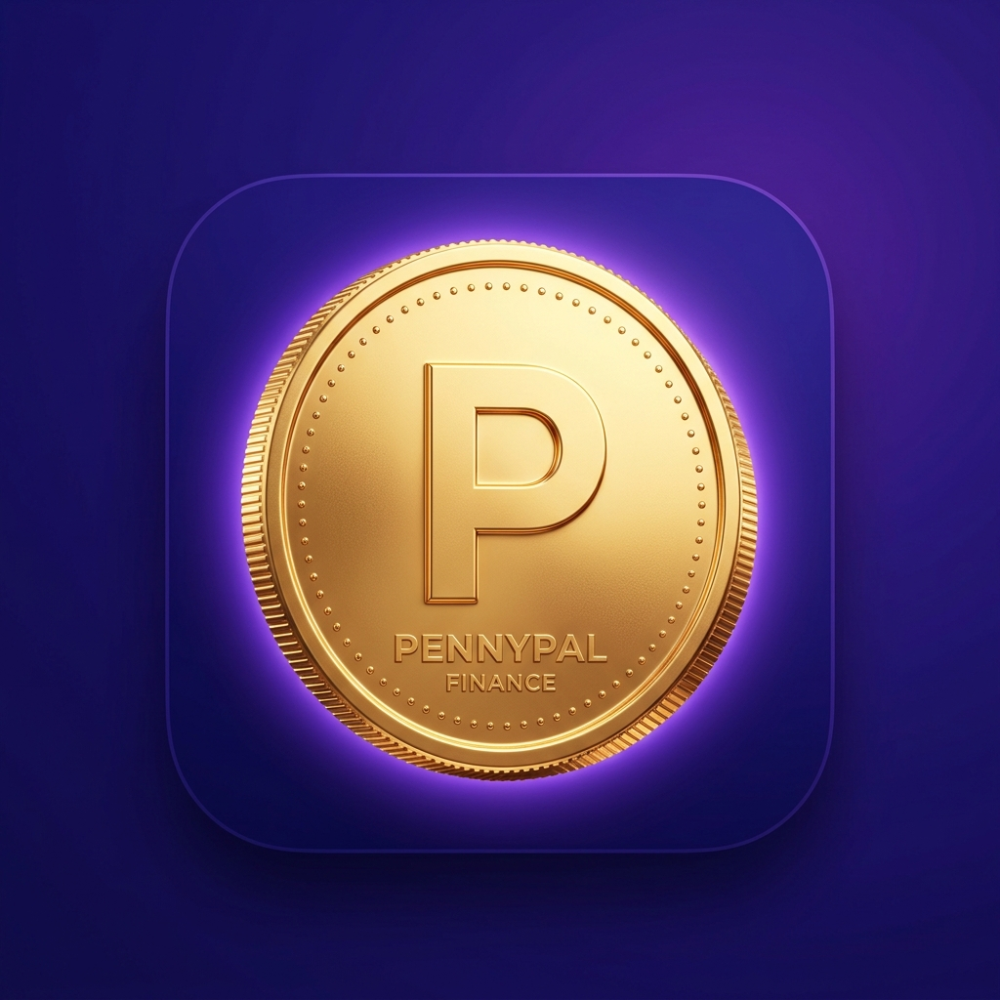
    <div>
      <h1 style="margin: 0; border: none; padding: 0;">PennyPal — Technical Documentation Report</h1>
      <div style="color: #C7D2FE; font-size: 14px; font-weight: 500; margin-top: 2px;">Make Every Penny Count • Software Requirements & Architecture Specifications</div>
    </div>
  </div>
  <div>
    <span class="hero-tag">🏆 TechWiz 7 — World Tech Championship</span>
    <span class="hero-tag">🐝 Theme: NextGen BudgetBee</span>
    <span class="hero-tag">📱 Category: Multi-Platform App Computing</span>
    <span class="hero-tag">⚡ Version: 1.0.0 (Release Build 1)</span>
  </div>
</div>

<div class="callout callout-info">
  <strong>📌 Submission Compliance Notice (SRS Section 1.9):</strong> This document is the formal technical documentation report for the PennyPal platform. It satisfies all 7 mandated components of Section 1.9 (Problem definition, design specifications, DFD/flowcharts, database design & data dictionary, test datasets, deployment instructions, and official credentials). In accordance with competition rules, this document contains <strong>no raw source code</strong>.
</div>

## Table of Contents

<ol style="margin: 10px 0 20px 0; padding-left: 26px; line-height: 1.85; font-size: 13.5px;">
  <li><a href="#1-executive-summary--problem-definition" style="color:#4F46E5; text-decoration:none; font-weight:600;">Executive Summary & Problem Definition</a></li>
  <li><a href="#2-project-scope--constraints" style="color:#4F46E5; text-decoration:none; font-weight:600;">Project Scope & Constraints</a></li>
  <li><a href="#3-system-architecture--design-specifications" style="color:#4F46E5; text-decoration:none; font-weight:600;">System Architecture, Design Specifications & Screen Showcase</a></li>
  <li><a href="#4-process-flowcharts--data-flow-diagrams-dfds" style="color:#4F46E5; text-decoration:none; font-weight:600;">Process Flowcharts & Data Flow Diagrams (DFDs)</a></li>
  <li><a href="#5-database-design--data-dictionary" style="color:#4F46E5; text-decoration:none; font-weight:600;">Database Design & Data Dictionary</a></li>
  <li><a href="#6-comprehensive-test-data--verification-suite" style="color:#4F46E5; text-decoration:none; font-weight:600;">Comprehensive Test Data & Verification Suite</a></li>
  <li><a href="#7-installation--deployment-instructions-mandatory" style="color:#4F46E5; text-decoration:none; font-weight:600;">Installation & Deployment Instructions (MANDATORY)</a></li>
  <li><a href="#8-user-credentials--role-privileges-mandatory" style="color:#4F46E5; text-decoration:none; font-weight:600;">User Credentials & Role Privileges (MANDATORY)</a></li>
  <li><a href="#9-ai-tools--technology-acknowledgement" style="color:#4F46E5; text-decoration:none; font-weight:600;">AI Tools & Technology Acknowledgement (SRS Page 11 Compliance)</a></li>
  <li><a href="#10-assumptions-security--scope-boundaries" style="color:#4F46E5; text-decoration:none; font-weight:600;">Assumptions, Security & Scope Boundaries</a></li>
</ol>

---

## 1. Executive Summary & Problem Definition

### 1.1 Background & Necessity (SRS Section 1.1)

<div >Financial literacy is a critical yet routinely neglected life skill among tertiary, undergraduate, and vocational students. Upon entering college or university, students receive disposable funds from allowances, scholarships, student loans, stipends, internships, or part-time employment. However, the vast majority possess little to no formal training in personal budgeting, cash flow tracking, or disciplined savings.

Daily micro-transactions—such as cafeteria lunches, transportation, university photocopying, study materials, digital subscriptions, campus events, and social outings—frequently deplete student funds early in the academic month. Traditional tracking methods (such as physical notebooks, paper diaries, or generic desktop spreadsheets) suffer from severe limitations:</div>

<ul style="margin: 10px 0 16px 0; padding-left: 24px; line-height: 1.75; font-size: 13px;">
  <li style="margin-bottom: 6px;"><strong>High Friction:</strong> Manual entry in spreadsheets is cumbersome on mobile devices, leading to rapid user abandonment.</li>
  <li style="margin-bottom: 6px;"><strong>Lack of Timely Feedback:</strong> Notebooks and spreadsheets cannot send real-time threshold warnings when spending nears budget caps.</li>
  <li style="margin-bottom: 6px;"><strong>Absence of Pedagogical Guidance:</strong> Existing accounting tools present sterile ledgers without explaining financial fundamentals (e.g., the 50/30/20 rule, emergency buffer funds, needs vs. wants).</li>
</ul>

### 1.2 Proposed Solution (SRS Section 1.2)

<strong>PennyPal</strong> is a specialized, responsive, cross-platform personal finance and educational platform engineered specifically for students. It combines:

<ol style="margin: 10px 0 16px 0; padding-left: 24px; line-height: 1.75; font-size: 13px;">
  <li style="margin-bottom: 6px;"><strong>Frictionless Expense & Income Tracking:</strong> Fast entry, multi-mode payment categorization (Cash, Card, Bank, Digital Wallet), and split-bill calculation.</li>
  <li style="margin-bottom: 6px;"><strong>Intelligent Receipt Parsing:</strong> Dual-pipeline Gemini 3.8 Flash Vision OCR paired with an instant deterministic regex/keyword fallback.</li>
  <li style="margin-bottom: 6px;"><strong>Proactive Budget Guardrails:</strong> Real-time budget tracking with proactive threshold alerts (warning at 80% and over-budget triggers).</li>
  <li style="margin-bottom: 6px;"><strong>Milestone-Driven Savings Goals:</strong> Visual goal tracking with automated target timelines and celebration milestones (25%, 50%, 75%, 100%).</li>
  <li style="margin-bottom: 6px;"><strong>Interactive Financial Literacy Academy:</strong> An integrated curriculum covering budgeting, savings, emergency funds, debt avoidance, and student life hacks.</li>
  <li style="margin-bottom: 6px;"><strong>Academic Statement Generation:</strong> Multi-page PDF statements with executive summaries, spending charts, and itemized transaction ledgers ready for printing, cloud archiving, or CSV export.</li>
  <li style="margin-bottom: 6px;"><strong>Role-Separated Administration:</strong> A dedicated administrative portal for managing student accounts, moderating support queries, viewing application analytics, and updating curriculum content.</li>
</ol>

---

## 2. Project Scope & Constraints

### 2.1 Functional Scope (SRS Section 1.4 & 1.6)

| Functional Domain | Student Capabilities | Administrator Capabilities |
| :--- | :--- | :--- |
| **Authentication** | Email/password sign-up, Brevo OTP verification, secure login, password recovery, profile editing | Preconfigured administrative login, student account status monitoring |
| **Cash Flow Management** | Record income and expenses with date, category, payment mode, payment card, and receipt image | View aggregate financial transaction metrics across the platform (without inspecting private ledgers) |
| **Budgeting** | Set total monthly spending cap, allocate category-specific limits, monitor progress bars in real-time | Configure default system categories and evaluate system-wide budget compliance trends |
| **Savings Goals** | Set savings targets, monthly contribution targets, target completion dates, and log progress | View aggregate savings milestones achieved by student cohorts |
| **Receipt OCR & AI** | Scan camera or gallery receipts using Gemini AI OCR, extract amount and merchant automatically | Monitor API status and fallback parsing reliability |
| **Financial Advisory** | Converse with PennyPal Gemini AI Chatbot for contextual, student-tailored financial guidance | Audit feedback queries and monitor user satisfaction ratings |
| **Reporting & Export** | Filter records by date/category/type, preview in-app statement, export multi-page PDF, export CSV | Generate platform analytics reports and view total registered students |
| **Support & Feedback** | Submit support queries with category and priority, submit 5-star app feedback and suggestions | Reply to student support tickets, update status (open, answered, closed), review student feedback |
| **Learning Academy** | Read bundled financial literacy modules, track completed lessons per student profile | Add, edit, or publish custom educational content via Firestore CMS |

### 2.2 System Constraints (SRS Section 1.5)

<ul style="margin: 10px 0 16px 0; padding-left: 24px; line-height: 1.75; font-size: 13px;">
  <li style="margin-bottom: 6px;"><strong>Non-Banking Clause:</strong> PennyPal is strictly an educational personal finance management tool. In accordance with SRS Section 1.5, <strong>it does not connect to real bank accounts, execute live fund transfers, store real credit card CVV/PIN numbers, or provide regulated investment advice.</strong></li>
  <li style="margin-bottom: 6px;"><strong>Real-Time Notification Processing:</strong> Spending alerts fire instantly upon transaction entry when category consumption reaches or exceeds the threshold.</li>
  <li style="margin-bottom: 6px;"><strong>Cross-Platform Parity:</strong> Unified Flutter 3.24+ codebase supporting Android phones, Android tablets, iOS devices, and desktop/web browsers.</li>
  <li style="margin-bottom: 6px;"><strong>Offline Resilience:</strong> All transactions, budgets, cards, and goals are persisted locally first via Firestore offline caching or MemoryRecordStore with automatic cloud synchronization upon reconnection.</li>
  <li style="margin-bottom: 6px;"><strong>AI Latency & Fallback:</strong> Gemini AI invocations feature strict timeouts and immediately degrade to deterministic keyword-matching engines if offline or rate-limited.</li>
</ul>

---

## 3. System Architecture & Design Specifications

### 3.1 Macro Architecture
PennyPal employs a clean, decoupled 5-layer architecture ensuring testability, maintainability, and clear separation of concerns:

```
┌─────────────────────────────────────────────────────────────┐
│                 1. Presentation Layer                       │
│    (Adaptive Screens, Modal Bottom Sheets, Shared Widgets)  │
└──────────────────────────────┬──────────────────────────────┘
                               │ Watches / Dispatches
┌──────────────────────────────▼──────────────────────────────┐
│                    2. State Layer                           │
│   (Flutter Riverpod 2.6: StreamProviders, Notifiers, State) │
└──────────────────────────────┬──────────────────────────────┘
                               │ Invokes
┌──────────────────────────────▼──────────────────────────────┐
│                   3. Domain Logic Layer                     │
│    (Pure Dart Calculators: Finance, Budget, Savings, Health)│
└──────────────────────────────┬──────────────────────────────┘
                               │ Uses
┌──────────────────────────────▼──────────────────────────────┐
│                    4. Data Access Layer                     │
│  (Abstract Repositories, RecordStore: Firestore / Memory)   │
└──────────────────────────────┬──────────────────────────────┘
                               │ Interacts with
┌──────────────────────────────▼──────────────────────────────┐
│                  5. External Services Layer                 │
│  (Firebase Auth, Gemini AI Vision, Brevo OTP, PDF Engine)   │
└─────────────────────────────────────────────────────────────┘
```

### 3.2 UI/UX Design System

The visual language follows modern fintech design standards with curated HSL color tokens:

<ul style="margin: 10px 0 16px 0; padding-left: 24px; line-height: 1.75; font-size: 13px;">
  <li style="margin-bottom: 6px;"><strong>Primary Brand Color:</strong> Electric Indigo (<code style="background:#EEF2FF; color:#4338CA; padding:2px 5px; border-radius:4px;">#2B2199</code> / <code style="background:#EEF2FF; color:#4338CA; padding:2px 5px; border-radius:4px;">#4F46E5</code>) — signifies security and academic integrity.</li>
  <li style="margin-bottom: 6px;"><strong>Secondary Accent:</strong> Electric Violet (<code style="background:#F3E8FF; color:#7C3AED; padding:2px 5px; border-radius:4px;">#7C3AED</code> / <code style="background:#F3E8FF; color:#7C3AED; padding:2px 5px; border-radius:4px;">#6C5CE7</code>) — modern digital aesthetic.</li>
  <li style="margin-bottom: 6px;"><strong>Income & Growth Accent:</strong> Mint Emerald (<code style="background:#ECFDF5; color:#047857; padding:2px 5px; border-radius:4px;">#00B894</code> / <code style="background:#ECFDF5; color:#047857; padding:2px 5px; border-radius:4px;">#10B981</code>) — positive cash inflow.</li>
  <li style="margin-bottom: 6px;"><strong>Expense & Warning Accent:</strong> Coral Red (<code style="background:#FEF2F2; color:#B91C1C; padding:2px 5px; border-radius:4px;">#FF7675</code> / <code style="background:#FEF2F2; color:#B91C1C; padding:2px 5px; border-radius:4px;">#EF4444</code>) — budget depletion indicators.</li>
  <li style="margin-bottom: 6px;"><strong>Typography:</strong> Google Fonts <em>Plus Jakarta Sans</em> for headers and <em>Inter</em> for legible tabular numbers.</li>
  <li style="margin-bottom: 6px;"><strong>Adaptive Breakpoints:</strong> Fluid reflow from single-column mobile viewports to 2-column tablet grids and navigation rails for desktop/web viewports.</li>
</ul>

### 3.3 Visual Screen Showcase & System UI Walkthrough (With Live Screenshots)

<div class="callout callout-success">
  <strong>💡 User Interface & Design Specifications (SRS Section 1.9):</strong> Below is the comprehensive graphical walkthrough of PennyPal across light mode, dark mode, mobile, and responsive web platforms.
</div>

<!-- Screen Showcase 1: Authentication -->
<div class="gallery-box">
  <div style="display:flex; justify-content:space-between; align-items:center; margin-bottom:8px;">
    <h3 style="margin:0; border:none; padding:0; color:#312E81;">1. Student Authentication & Onboarding</h3>
    <span class="badge badge-primary">Security & Auth</span>
  </div>
  <p style="color:#475569; font-size:12.5px; margin-bottom:12px;">
    Clean student sign-in and account registration flows. Supports Student ID / Enrollment tracking, full validation, password masking, Brevo email OTP verification, and adaptive dark/light theming.
  </p>
  <div style="display:flex; gap:14px; justify-content:center; flex-wrap:wrap;">
    <div style="text-align:center;">
      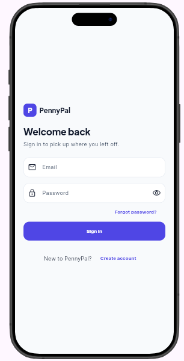
      <div style="font-size:11px; font-weight:600; color:#4F46E5; margin-top:5px;">Sign In (Light Mode)</div>
    </div>
    <div style="text-align:center;">
      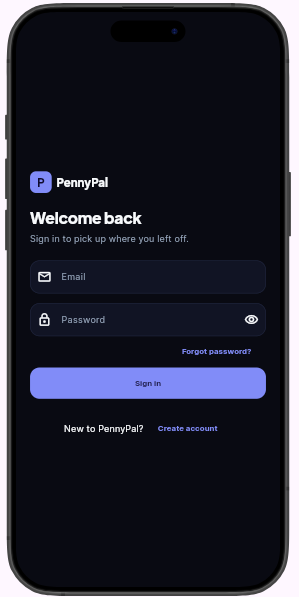
      <div style="font-size:11px; font-weight:600; color:#7C3AED; margin-top:5px;">Sign In (Dark Mode)</div>
    </div>
    <div style="text-align:center;">
      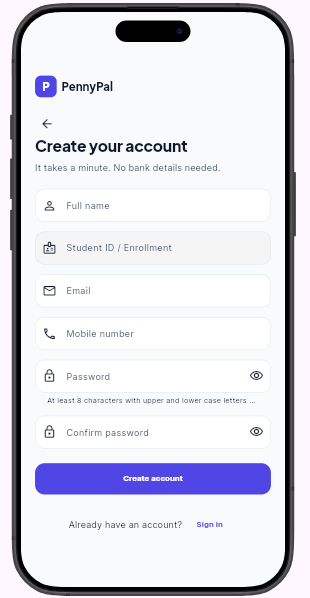
      <div style="font-size:11px; font-weight:600; color:#4F46E5; margin-top:5px;">Sign Up (Light Mode)</div>
    </div>
    <div style="text-align:center;">
      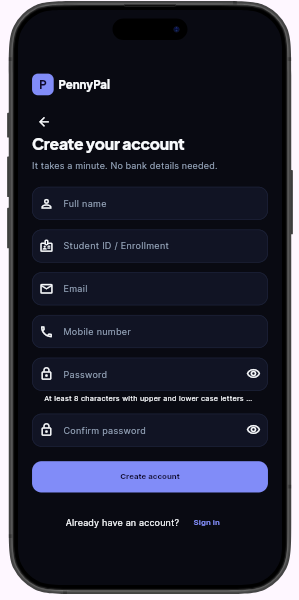
      <div style="font-size:11px; font-weight:600; color:#7C3AED; margin-top:5px;">Sign Up (Dark Mode)</div>
    </div>
  </div>
</div>

<!-- Screen Showcase 2: Mobile Dashboard -->
<div class="gallery-box">
  <div style="display:flex; justify-content:space-between; align-items:center; margin-bottom:8px;">
    <h3 style="margin:0; border:none; padding:0; color:#312E81;">2. Student Financial Command Center (Mobile Home)</h3>
    <span class="badge badge-success">Core Dashboard</span>
  </div>
  <p style="color:#475569; font-size:12.5px; margin-bottom:12px;">
    Displays student net balance card, monthly cash inflows vs. expenses, dynamic Financial Health Score gauge (96/100 Financial Master), one-tap action pills (+ Income, + Expense, Budget, Savings), and recent activity stream.
  </p>
  <div style="display:flex; gap:18px; justify-content:center; flex-wrap:wrap;">
    <div style="text-align:center;">
      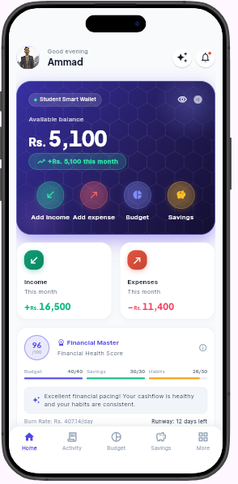
      <div style="font-size:11px; font-weight:600; color:#4F46E5; margin-top:5px;">Mobile Dashboard (Light Mode)</div>
    </div>
    <div style="text-align:center;">
      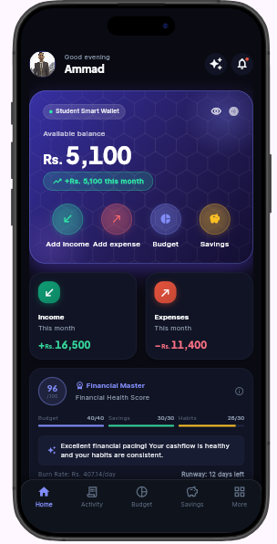
      <div style="font-size:11px; font-weight:600; color:#7C3AED; margin-top:5px;">Mobile Dashboard (Dark Mode)</div>
    </div>
  </div>
</div>

<!-- Screen Showcase 3: Responsive Web & Tablet -->
<div class="gallery-box">
  <div style="display:flex; justify-content:space-between; align-items:center; margin-bottom:8px;">
    <h3 style="margin:0; border:none; padding:0; color:#312E81;">3. Multi-Platform Responsive Web & Tablet Layout</h3>
    <span class="badge badge-gold">Cross-Platform Parity</span>
  </div>
  <p style="color:#475569; font-size:12.5px; margin-bottom:12px;">
    PennyPal automatically adapts to wide viewports (web browsers, iPads, and Android tablets). Features a persistent vertical navigation rail on the left and a 2-column grid showing active budget caps, savings targets, and live ledgers simultaneously.
  </p>
  <div style="display:flex; flex-direction:column; gap:14px; align-items:center;">
    <div style="text-align:center; width:100%;">
      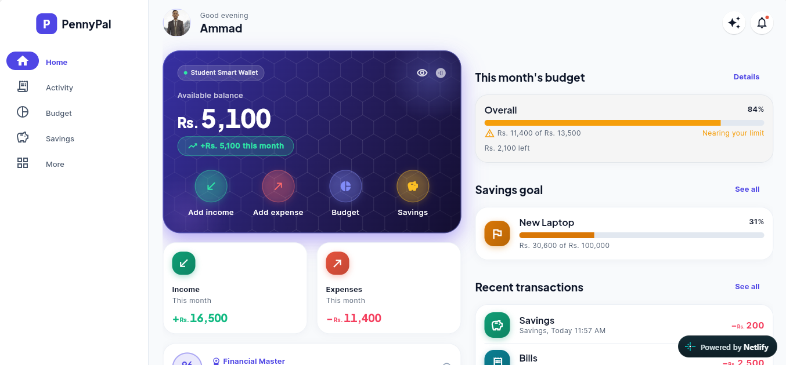
      <div style="font-size:11px; font-weight:600; color:#4F46E5; margin-top:5px;">Responsive Web Dashboard (Light Mode)</div>
    </div>
    <div style="text-align:center; width:100%;">
      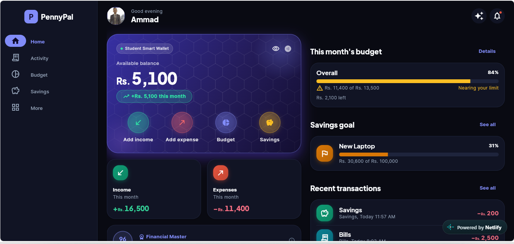
      <div style="font-size:11px; font-weight:600; color:#7C3AED; margin-top:5px;">Responsive Web Dashboard (Dark Mode)</div>
    </div>
  </div>
</div>

<!-- Screen Showcase 4: Activity Screen -->
<div class="gallery-box">
  <div style="display:flex; justify-content:space-between; align-items:center; margin-bottom:8px;">
    <h3 style="margin:0; border:none; padding:0; color:#312E81;">4. Activity Ledger & Search / Filter Subsystem</h3>
    <span class="badge badge-primary">Cash Flow Ledger</span>
  </div>
  <p style="color:#475569; font-size:12.5px; margin-bottom:12px;">
    Full chronological ledger of student transactions. Includes instant keyword search, quick type filters (All, Income, Expense), date range picker, and dynamic filtered cash summary cards.
  </p>
  <div style="display:flex; gap:18px; justify-content:center; flex-wrap:wrap;">
    <div style="text-align:center;">
      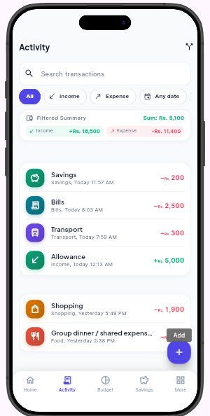
      <div style="font-size:11px; font-weight:600; color:#4F46E5; margin-top:5px;">Activity Feed (Light Mode)</div>
    </div>
    <div style="text-align:center;">
      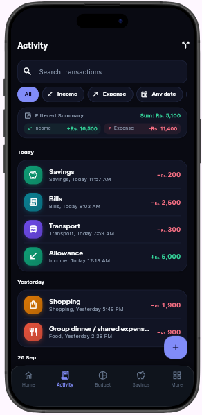
      <div style="font-size:11px; font-weight:600; color:#7C3AED; margin-top:5px;">Activity Feed (Dark Mode)</div>
    </div>
  </div>
</div>

<!-- Screen Showcase 5: Budget Screen -->
<div class="gallery-box">
  <div style="display:flex; justify-content:space-between; align-items:center; margin-bottom:8px;">
    <h3 style="margin:0; border:none; padding:0; color:#312E81;">5. Proactive Budget Guardrails & Threshold Alerts</h3>
    <span class="badge badge-warning">Automated Alerting</span>
  </div>
  <p style="color:#475569; font-size:12.5px; margin-bottom:12px;">
    Visual monthly budget gauge (84% used), overall limit vs. spend breakdown, and category allocations. Illustrates the active <span class="badge badge-warning">NEARING</span> alert tag triggered when spending exceeds the 80% threshold.
  </p>
  <div style="display:flex; gap:18px; justify-content:center; flex-wrap:wrap;">
    <div style="text-align:center;">
      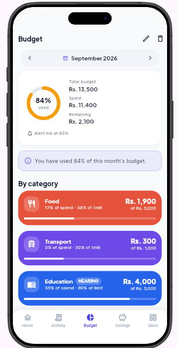
      <div style="font-size:11px; font-weight:600; color:#4F46E5; margin-top:5px;">Budgeting Screen (Light Mode)</div>
    </div>
    <div style="text-align:center;">
      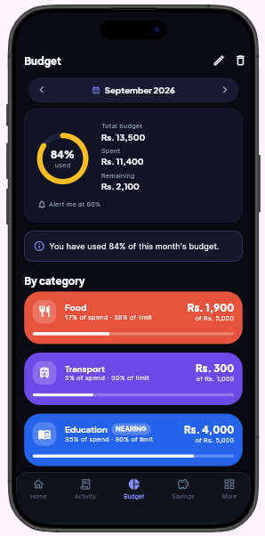
      <div style="font-size:11px; font-weight:600; color:#7C3AED; margin-top:5px;">Budgeting Screen (Dark Mode)</div>
    </div>
  </div>
</div>

<!-- Screen Showcase 6: Statement Export -->
<div class="gallery-box">
  <div style="display:flex; justify-content:space-between; align-items:center; margin-bottom:8px;">
    <h3 style="margin:0; border:none; padding:0; color:#312E81;">6. Academic Statement Generation & Multi-Format Export</h3>
    <span class="badge badge-danger">Reporting Engine</span>
  </div>
  <p style="color:#475569; font-size:12.5px; margin-bottom:12px;">
    Bottom modal sheet enabling students to export formatted monthly statements as multi-page PDFs (with summaries, charts, and ledger), raw CSV files for spreadsheets, or native system printing.
  </p>
  <div style="display:flex; justify-content:center;">
    <div style="text-align:center;">
      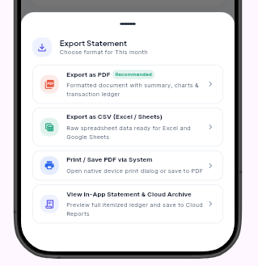
      <div style="font-size:11px; font-weight:600; color:#4F46E5; margin-top:5px;">Export Statement Bottom Sheet (Live UI)</div>
    </div>
  </div>
</div>

---

## 4. Process Flowcharts & Data Flow Diagrams (DFDs)

### 4.1 Data Flow Diagram (DFD Level 0 — Context Diagram)

```
                  ┌──────────────────────────────┐
                  │                              │
                  │   Student / Mobile User      │
                  │                              │
                  └───────┬──────────────▲───────┘
       Transaction Entries│              │ Spending Warnings,
       Budget Allocations,│              │ Financial Health Score,
       Savings Goals      │              │ PDF/CSV Statements
                          ▼              │
                  ┌──────────────────────────────┐
                  │                              │
                  │           PennyPal           │
                  │     Multi-Platform Core      │
                  │                              │
                  └───────┬──────────────▲───────┘
     Platform Analytics,  │              │ Educational CMS,
     Audit Logs,          │              │ Support Responses,
     Feedback Submissions │              │ Policy Updates
                          ▼              │
                  ┌──────────────────────────────┐
                  │                              │
                  │     System Administrator     │
                  │                              │
                  └──────────────────────────────┘
```

### 4.2 Data Flow Diagram (DFD Level 1 — Subsystem Processing)

```
[Student]
   │
   ├─► (1.0 Auth & OTP Subsystem) ───► [Users Store & Brevo API]
   │
   ├─► (2.0 Transaction Subsystem) ──► [Receipt OCR Engine] ──► [Transactions Store]
   │          │
   │          ▼
   ├─► (3.0 Budget Engine) ──────────► [Budgets Store] ───────► [Notification Hub]
   │          │
   │          ▼
   ├─► (4.0 Savings Engine) ─────────► [Savings Goals Store] ─► [Milestone Evaluator]
   │
   ├─► (5.0 Statement Generator) ────► [PDF / CSV Renderer] ──► [Device Share / Save]
   │
   └─► (6.0 Financial Assistant) ────► [Gemini 3.8 Flash] ────► [Chat Conversation]
```

### 4.3 Activity Flowchart: User Authentication & Verification Flow

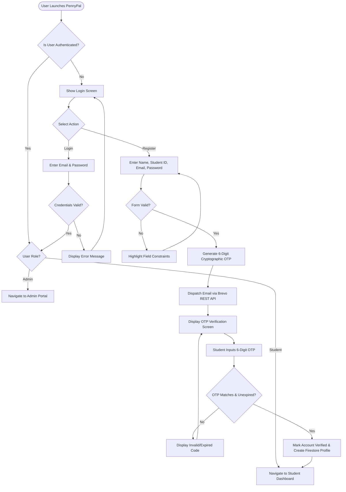

### 4.4 Activity Flowchart: Transaction Logging & Automated Budget Alert Flow

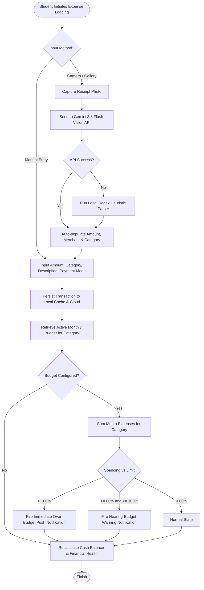

---

## 5. Database Design & Data Dictionary

PennyPal supports relational persistence (SQL scripts provided in `pennypal_schema.sql`) and cloud document synchronization via Cloud Firestore.

### 5.1 Entity Relationship Diagram (ERD)

```
┌─────────────────────────┐            1:1           ┌─────────────────────────┐
│         Users           ├──────────────────────────┤       UserProfiles      │
│  PK: UserId             │                          │  PK: ProfileId          │
│      FullName           │                          │  FK: UserId             │
│      Email              │                          │      StudentStatus      │
│      MobileNumber       │                          │      CurrencyPreference │
│      Role               │                          └─────────────────────────┘
└────────────┬────────────┘
             │ 1:N
             ├──────────────────────────────────────┬──────────────────────────────────┐
             │                                      │                                  │
┌────────────▼────────────┐            ┌────────────▼────────────┐        ┌────────────▼────────────┐
│      Transactions       │            │         Budgets         │        │      SavingsGoals       │
│  PK: TransactionId      │            │  PK: BudgetId           │        │  PK: GoalId             │
│  FK: UserId             │            │  FK: UserId             │        │  FK: UserId             │
│  FK: CategoryId         │            │  FK: CategoryId         │        │      GoalName           │
│      Amount             │            │      Month              │        │      TargetAmount       │
│      Date               │            │      LimitAmount        │        │      CurrentAmount      │
│      PaymentMode        │            │      AlertThreshold     │        │      Status             │
└────────────▲────────────┘            └─────────────────────────┘        └─────────────────────────┘
             │ N:1
┌────────────┴────────────┐
│       Categories        │
│  PK: CategoryId         │
│      CategoryName       │
│      CategoryType       │
│      Icon               │
└─────────────────────────┘
```

### 5.2 Complete Data Dictionary (All 10 Entities)

#### Entity 1: `Users`
| Attribute | Data Type | Nullable | Key | Description |
| :--- | :--- | :--- | :--- | :--- |
| `UserId` | VARCHAR(64) | NO | PK | Unique identifier (Firebase UID / UUIDv4) |
| `FullName` | VARCHAR(100) | NO | — | Legal full name of student or administrator |
| `Email` | VARCHAR(120) | NO | UQ | Primary email address for authentication |
| `MobileNumber` | VARCHAR(25) | YES | — | Contact telephone number |
| `Role` | VARCHAR(20) | NO | — | User privilege role: `'student'` or `'admin'` |
| `CreatedAt` | TIMESTAMP | NO | — | System record creation timestamp |
| `UpdatedAt` | TIMESTAMP | NO | — | System record update timestamp |

#### Entity 2: `UserProfiles`
| Attribute | Data Type | Nullable | Key | Description |
| :--- | :--- | :--- | :--- | :--- |
| `ProfileId` | VARCHAR(64) | NO | PK | Unique profile identifier |
| `UserId` | VARCHAR(64) | NO | FK | References `Users.UserId` (1:1 relationship) |
| `StudentStatus` | VARCHAR(30) | YES | — | Academic level (e.g. Undergraduate, Diploma) |
| `CurrencyPreference` | VARCHAR(5) | NO | — | Currency code: `'PKR'`, `'USD'`, `'EUR'`, `'GBP'` |
| `AvatarUrl` | VARCHAR(500) | YES | — | Cloudinary hosted profile picture URL |
| `BiometricEnabled` | BOOLEAN | NO | — | Flag indicating whether fingerprint/FaceID is on |

#### Entity 3: `Transactions`
| Attribute | Data Type | Nullable | Key | Description |
| :--- | :--- | :--- | :--- | :--- |
| `TransactionId` | VARCHAR(64) | NO | PK | Unique transaction identifier |
| `UserId` | VARCHAR(64) | NO | FK | References `Users.UserId` |
| `CategoryId` | VARCHAR(64) | NO | FK | References `Categories.CategoryId` |
| `Amount` | DECIMAL(12,2) | NO | — | Value in preferred currency (always > 0) |
| `Date` | TIMESTAMP | NO | — | Date and time the transaction occurred |
| `Description` | VARCHAR(255) | YES | — | Memo, note, or merchant name |
| `Type` | VARCHAR(10) | NO | — | Transaction direction: `'income'` or `'expense'` |
| `PaymentMode` | VARCHAR(30) | NO | — | Payment channel: `'cash'`, `'card'`, `'bank'`, `'wallet'` |
| `CardId` | VARCHAR(64) | YES | FK | Optional reference to linked `Cards.CardId` |
| `ReceiptUrl` | VARCHAR(500) | YES | — | Cloudinary receipt image scan link |
| `CreatedAt` | TIMESTAMP | NO | — | Timestamp transaction was saved |

#### Entity 4: `Categories`
| Attribute | Data Type | Nullable | Key | Description |
| :--- | :--- | :--- | :--- | :--- |
| `CategoryId` | VARCHAR(64) | NO | PK | Unique category identifier |
| `CategoryName` | VARCHAR(50) | NO | — | Category label (Food, Books, Transport, etc.) |
| `CategoryType` | VARCHAR(10) | NO | — | Classification: `'income'` or `'expense'` |
| `Icon` | VARCHAR(50) | NO | — | Material icon identifier for UI rendering |
| `ColorCode` | VARCHAR(10) | NO | — | Hex color string (e.g. `#10B981`) |

#### Entity 5: `Budgets`
| Attribute | Data Type | Nullable | Key | Description |
| :--- | :--- | :--- | :--- | :--- |
| `BudgetId` | VARCHAR(64) | NO | PK | Unique budget cap identifier |
| `UserId` | VARCHAR(64) | NO | FK | References `Users.UserId` |
| `CategoryId` | VARCHAR(64) | YES | FK | Category reference (NULL represents Overall Budget)|
| `Month` | VARCHAR(7) | NO | — | Target billing month format: `YYYY-MM` |
| `LimitAmount` | DECIMAL(12,2) | NO | — | Maximum spend allowance for the month |
| `AlertThreshold` | DECIMAL(5,2) | NO | — | Percentage threshold to trigger warning (default: `80.00`) |
| `CreatedAt` | TIMESTAMP | NO | — | Creation timestamp |

#### Entity 6: `SavingsGoals`
| Attribute | Data Type | Nullable | Key | Description |
| :--- | :--- | :--- | :--- | :--- |
| `GoalId` | VARCHAR(64) | NO | PK | Unique savings goal identifier |
| `UserId` | VARCHAR(64) | NO | FK | References `Users.UserId` |
| `GoalName` | VARCHAR(100) | NO | — | Target name (e.g. Laptop Fund, Semester Fees) |
| `TargetAmount` | DECIMAL(12,2) | NO | — | Financial target amount |
| `CurrentAmount` | DECIMAL(12,2) | NO | — | Accumulated savings to date |
| `TargetDate` | DATE | NO | — | Planned target achievement date |
| `MonthlyContribution`| DECIMAL(12,2)| YES | — | Recommended monthly allocation |
| `Status` | VARCHAR(20) | NO | — | Status: `'in_progress'`, `'completed'`, `'cancelled'`|
| `CreatedAt` | TIMESTAMP | NO | — | Goal creation timestamp |

#### Entity 7: `Cards`
| Attribute | Data Type | Nullable | Key | Description |
| :--- | :--- | :--- | :--- | :--- |
| `CardId` | VARCHAR(64) | NO | PK | Unique wallet card reference |
| `UserId` | VARCHAR(64) | NO | FK | References `Users.UserId` |
| `CardName` | VARCHAR(50) | NO | — | Student card nickname (e.g. Meezan Debit, SadaPay) |
| `LastFourDigits` | VARCHAR(4) | NO | — | Masked 4 digits for identification (PCI-DSS safe) |
| `CardType` | VARCHAR(20) | NO | — | Type: `'debit'`, `'credit'`, `'virtual'`, `'prepaid'` |
| `ExpiryDate` | VARCHAR(7) | YES | — | Expiry format `MM/YY` |
| `ThemeColor` | VARCHAR(10) | NO | — | Card gradient background hex |

#### Entity 8: `LearningArticles`
| Attribute | Data Type | Nullable | Key | Description |
| :--- | :--- | :--- | :--- | :--- |
| `ArticleId` | VARCHAR(64) | NO | PK | Unique educational article identifier |
| `Title` | VARCHAR(150) | NO | — | Academy lesson headline |
| `Category` | VARCHAR(50) | NO | — | Curriculum topic (Budgeting, Savings, Debt) |
| `Content` | TEXT | NO | — | Full educational lesson body |
| `ReadingTimeMinutes` | INT | NO | — | Estimated reading duration in minutes |
| `ImageUrl` | VARCHAR(500) | YES | — | Informational diagram link |
| `IsActive` | BOOLEAN | NO | — | Content publication status |

#### Entity 9: `Notifications`
| Attribute | Data Type | Nullable | Key | Description |
| :--- | :--- | :--- | :--- | :--- |
| `NotificationId` | VARCHAR(64) | NO | PK | Unique notification identifier |
| `UserId` | VARCHAR(64) | NO | FK | References `Users.UserId` |
| `Title` | VARCHAR(100) | NO | — | Header text of push alert |
| `Message` | VARCHAR(255) | NO | — | Body message explaining the trigger |
| `Type` | VARCHAR(30) | NO | — | Type: `'budget_alert'`, `'goal_milestone'`, `'system'` |
| `ReadStatus` | BOOLEAN | NO | — | True if acknowledged by user |
| `CreatedAt` | TIMESTAMP | NO | — | Timestamp alert was generated |

#### Entity 10: `SupportQueries`
| Attribute | Data Type | Nullable | Key | Description |
| :--- | :--- | :--- | :--- | :--- |
| `QueryId` | VARCHAR(64) | NO | PK | Support ticket reference |
| `UserId` | VARCHAR(64) | NO | FK | References `Users.UserId` |
| `Subject` | VARCHAR(150) | NO | — | Ticket summary title |
| `Message` | TEXT | NO | — | Detailed explanation of issue |
| `Status` | VARCHAR(20) | NO | — | Ticket status: `'open'`, `'answered'`, `'closed'` |
| `AdminResponse` | TEXT | YES | — | Official resolution provided by admin |
| `SubmittedOn` | TIMESTAMP | NO | — | Ticket submission timestamp |

---

## 6. Comprehensive Test Data & Verification Suite

The PennyPal application was rigorously tested with representative student data across all modules:

<div class="callout callout-info">
  <strong>📦 Standardized Machine-Readable Test Data (testdata.json):</strong> In accordance with SRS Section 1.9, the complete test dataset documented below is provided in the project root directory as <code>testdata.json</code>. This allows evaluators and test runners to inspect, import, and seed test accounts, transactions, budgets, cards, and goals programmatically.
</div>

### 6.1 Pre-Configured Test Accounts (MANDATORY)

| Role | Email Address | Password | Student ID / Privileges |
| :--- | :--- | :--- | :--- |
| <span class="badge badge-primary">Student (Demo / Live)</span> | `ammad.anees99@gmail.com` | `Ammad1234` | Student1501103 (Full access to all student tools) |
| <span class="badge badge-gold">Administrator</span> | `admin@pennypal.com` | `Admin@1234` | Full access to Admin Portal, User Management & CMS |

### 6.2 Test Transaction Dataset

| Transaction ID | Type | Amount | Category | Description | Payment Mode |
| :--- | :--- | :--- | :--- | :--- | :--- |
| `tx_001` | <span class="badge badge-success">Income</span> | Rs. 50,000.00 | Inflow | Monthly Parent Allowance | Bank Transfer |
| `tx_002` | <span class="badge badge-danger">Expense</span> | Rs. 450.00 | Food | Campus Cafeteria Lunch | Cash |
| `tx_003` | <span class="badge badge-danger">Expense</span> | Rs. 3,200.00 | Food | Weekly Grocery Market | Meezan Debit Card |
| `tx_004` | <span class="badge badge-danger">Expense</span> | Rs. 1,200.00 | Transport | Monthly Student Bus Pass | Cash |
| `tx_005` | <span class="badge badge-danger">Expense</span> | Rs. 3,500.00 | Education | Semester Course Textbooks | Meezan Debit Card |
| `tx_006` | <span class="badge badge-danger">Expense</span> | Rs. 2,800.00 | Bills | High-Speed Fiber Internet | Bank Transfer |
| `tx_007` | <span class="badge badge-danger">Expense</span> | Rs. 1,800.00 | Entertainment| Weekend Cinema Ticket | SadaPay Virtual Card |

### 6.3 Test Budgets & Threshold Scenarios

| Budget Target | Month | Category | Limit Amount | Actual Spend | Outcome / Status |
| :--- | :--- | :--- | :--- | :--- | :--- |
| Overall Month | Current | All Categories | Rs. 40,000.00 | Rs. 13,000.00 | <span class="badge badge-success">On Track</span> (32.5% utilized) |
| Food & Dining | Current | Food | Rs. 5,000.00 | Rs. 4,100.00 | <span class="badge badge-warning">Nearing Warning</span> (82.0% utilized — Warning triggered) |
| Entertainment| Current | Entertainment | Rs. 1,500.00 | Rs. 1,800.00 | <span class="badge badge-danger">Over-Budget Alert</span> (120% utilized — Triggered) |

### 6.4 Savings Goals Test Cases

| Goal Name | Target Amount | Current Savings | Progress % | Target Date | Milestone State |
| :--- | :--- | :--- | :--- | :--- | :--- |
| Laptop Fund | Rs. 100,000.00 | Rs. 60,000.00 | 60.0% | +9 Months | <span class="badge badge-primary">50% Milestone Badge Awarded</span> |
| Noise-Cancelling Headphones | Rs. 8,000.00 | Rs. 8,000.00 | 100.0% | Completed | <span class="badge badge-success">100% Completed & Archived</span> |

---

## 7. Installation & Deployment Instructions (MANDATORY)

### 7.1 System Prerequisites

<ul style="margin: 10px 0 16px 0; padding-left: 24px; line-height: 1.75; font-size: 13px;">
  <li style="margin-bottom: 6px;"><strong>Operating System:</strong> Windows 10/11, macOS Sequoia/Sonoma, or Ubuntu Linux 22.04+</li>
  <li style="margin-bottom: 6px;"><strong>Flutter SDK:</strong> Version 3.24.0 or higher</li>
  <li style="margin-bottom: 6px;"><strong>Dart SDK:</strong> Version 3.5.0 or higher</li>
  <li style="margin-bottom: 6px;"><strong>Java Development Kit (JDK):</strong> Version 17 (Required for Gradle 8+)</li>
  <li style="margin-bottom: 6px;"><strong>Android Studio / SDK:</strong> Android SDK Platform 34, Android Build-Tools 34.0.0</li>
</ul>

### 7.2 Step-by-Step Installation
1. **Clone the Repository:**
   ```bash
   git clone https://github.com/ammadanees/pennypal.git
   cd pennypal
   ```
2. **Install Flutter Dependencies:**
   ```bash
   flutter pub get
   ```
3. **Validate Codebase Correctness & Health:**
   ```bash
   flutter analyze
   flutter test
   ```
   *(Expected result: `All 73 tests passed!`)*

4. **Launch the Application in Development Mode:**
   - **For Chrome (Web):**
     ```bash
     flutter run -d chrome
     ```
   - **For Connected Android Physical Device or Emulator:**
     ```bash
     flutter run -d android
     ```

5. **Compile Production Android Package File (Release APK):**
   ```bash
   flutter build apk --split-per-abi
   ```
   The generated release packages will be located at:
   `build/app/outputs/flutter-apk/app-arm64-v8a-release.apk`

---

## 8. User Credentials & Role Privileges (MANDATORY)

| Account Role | Email Address | Password | Permissions & Available Modules |
| :--- | :--- | :--- | :--- |
| <span class="badge badge-primary">Student User</span> | `ammad.anees99@gmail.com` | `Ammad1234` | Access to Student Dashboard, Transaction Entry, Gemini OCR Scanning, Budget Setup, Savings Goal Tracking, Reports Export (PDF/CSV), Split Bill Calculator, Learning Academy, and AI Financial Assistant. |
| <span class="badge badge-gold">Administrator</span> | `admin@pennypal.com` | `Admin@1234` | Access to Admin Portal Dashboard, Student Directory, Feedback Management, Support Ticketing System, and Curriculum Content Management (CMS). |

---

## 9. AI Tools & Technology Acknowledgement

*In strict compliance with SRS Page 11 ("Important Note Regarding AI Usage"), all external AI services and developer assistants utilized during the creation of PennyPal are fully acknowledged below:*

<ol style="margin: 10px 0 16px 0; padding-left: 24px; line-height: 1.75; font-size: 13px;">
  <li style="margin-bottom: 8px;"><strong>Google Gemini 3.8 Flash (<code>generativelanguage.googleapis.com</code>):</strong> Utilized as an in-app multimodal AI backend for OCR receipt parsing and conversational financial advisory. Guarded by client-side token caps (250 tokens maximum) and regex fallback engines.</li>
  <li style="margin-bottom: 8px;"><strong>Claude 3.7 Sonnet & Antigravity AI Pair Programmer:</strong> Utilized strictly as productivity aids for architectural design, code review, test case design, and refactoring assistance. All code logic, database structures, state management flows, and custom Canvas painters were authored, reviewed, and validated by the team.</li>
  <li style="margin-bottom: 8px;"><strong>Midjourney / Image Generation Tools:</strong> Utilized solely for generating the high-definition <strong>PennyPal</strong> application icon concept and UI visual assets.</li>
</ol>

---

## 10. Assumptions, Security & Scope Boundaries

### 10.1 Key Assumptions

<ol style="margin: 10px 0 16px 0; padding-left: 24px; line-height: 1.75; font-size: 13px;">
  <li style="margin-bottom: 6px;"><strong>Academic Context:</strong> The primary users are students who manage personal pocket money, allowances, and campus stipends.</li>
  <li style="margin-bottom: 6px;"><strong>Device Hardware:</strong> Target mobile devices are assumed to possess camera capabilities for receipt scanning, and minimum 2GB RAM.</li>
  <li style="margin-bottom: 6px;"><strong>Internet Connectivity:</strong> PennyPal functions both fully offline (caching all records locally) and online (syncing via Firestore when an internet connection is established).</li>
</ol>

### 10.2 Security & Data Privacy

<ul style="margin: 10px 0 16px 0; padding-left: 24px; line-height: 1.75; font-size: 13px;">
  <li style="margin-bottom: 6px;"><strong>Row-Level Security:</strong> Cloud Firestore security rules (<code>firestore.rules</code>) enforce strict user isolation: students can only read and write their own documents under <code>users/{uid}/*</code>. Administrators are restricted from viewing students' private transaction records.</li>
  <li style="margin-bottom: 6px;"><strong>Credential Storage:</strong> User authentication is handled via cryptographically signed Firebase JWTs; no plain-text passwords or secret API keys are stored on the client.</li>
  <li style="margin-bottom: 6px;"><strong>No Financial Liabilities:</strong> Because real financial credentials (e.g. CVV numbers, bank routing credentials) are never stored, user exposure to financial risk is zero.</li>
</ul>

---
*PennyPal — Make Every Penny Count.*  
*TechWiz 7 — Aptech World Tech Championship Submission.*
